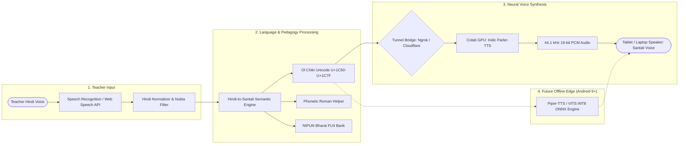
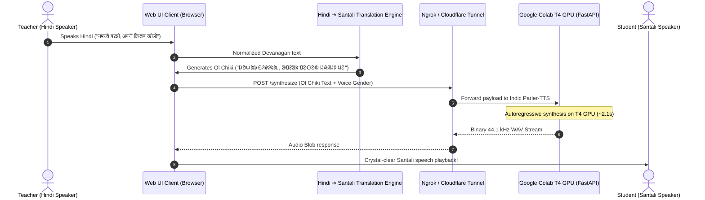

# MatrVaani (मातृवाणी / ᱢᱟᱛᱨᱤᱵᱟᱬᱤ)

<div align="center">

[](#-hackathon-recognition)
[](https://aliaarish17.github.io/MatrVaani/)
[](LICENSE)
[](https://www.python.org/)
[](https://huggingface.co/datasets/ai4bharat/Rasa)
[](https://huggingface.co/ai4bharat/indic-parler-tts-pretrained)

### **Assistive Vernacular Pedagogy & Real-Time Speech Synthesis Suite**
*Empowering Mother Tongue-Based Multilingual Education (MTB-MLE) in Indigenous Classrooms*

[🌐 **Live Web Prototype**](https://aliaarish17.github.io/MatrVaani/) • [📖 **Documentation Hub**](docs/README.md) • [🚀 **Colab Setup Guide**](docs/guides/COLAB_TUNNEL_DEPLOYMENT.md) • [📊 **Architecture Spec**](docs/architecture/SYSTEM_ARCHITECTURE.md)

</div>

---

## 🏆 Hackathon Recognition

> **Smart India Hackathon (SIH) Internal Hackathon Finalist**  
> 🏅 **Ranked 6th Position out of 60+ Competing Engineering Teams**  
> Recognized for high technical feasibility, impactful indigenous domain focus, and end-to-end operational execution bridging low-resource language synthesis with classroom pedagogy.

---

## 🌍 The Problem & Societal Mission

In primary schools throughout Jharkhand's tribal heartlands, government teachers predominantly teach in **standard Hindi**, while indigenous children entering foundational grades (Class 1–3) speak their native mother tongue—predominantly **Santali (ᱥᱟᱱᱛᱟᱲᱤ)** written in **Ol Chiki (ᱚᱞ ᱪᱤᱠᱤ)** script, as well as **Ho (Warang Citi)** and **Mundari (Mundari Bani)**.

This linguistic gap results in:
- **Severe Foundational Literacy & Numeracy (FLN) Deficits**: Children struggle with basic numeracy and alphabet concepts simply because they do not understand Hindi instruction.
- **High Early Dropout Rates**: Alienation in the classroom leads to disengagement.
- **Teacher Bottlenecks**: Non-native teachers lack practical, accessible tools to communicate with their students in their native idiom.

**MatrVaani** was engineered as an assistive, real-time voice and pedagogical bridge for Jharkhand's **PALASH (MTB-MLE)** programme and national **NIPUN Bharat FLN** guidelines. Non-native teachers speak standard Hindi naturally, and MatrVaani instantly translates, displays authentic Ol Chiki Unicode, and synthesizes natural Santali speech in **< 2.5 seconds**.

---

## 💡 Key Highlights & Capabilities

- 🎙️ **Real-Time Hindi ASR & Speech Normalizer**:
  Browser-based voice input via Web Speech API with automatic Nukta/Matra filtering and phoneme stabilization.
- 🔄 **Vernacular NMT & NIPUN Bharat FLN Bank**:
  Meaning-based translation engine paired with an integrated **FLN Master Bank of 27 pedagogical phrases** across daily classroom instructions, praise & encouragement, discipline, activities, and greetings.
- 🔤 **Native Ol Chiki Unicode Rendering (`U+1C50`–`U+1C7F`)**:
  Full native script display paired with true phonetic Roman transliteration and an on-screen collapsible Ol Chiki virtual keyboard.
- 🔊 **Fine-Tuned Santali Neural TTS (AI4Bharat Indic Parler-TTS)**:
  Fine-tuned on the Santali split of the `ai4bharat/Rasa` studio-recorded corpus, producing expressive 44.1 kHz Santali speech with controllable male/female vocal profiles.
- ⚡ **Live Colab GPU Bridge with Tunnel Automation**:
  FastAPI server designed for free Google Colab T4/A100 GPUs, bridged directly to the browser front-end using Ngrok / Cloudflare tunnels with automatic CORS and header handling.
- 📱 **Offline Edge Scaling Roadmap**:
  Architected to quantize down from 3.75 GB FP32 to **INT8 dynamic weights (< 1.4 GB)** and future **ONNX Piper-TTS (~45 MB)** to run 100% offline on budget 2GB RAM Android tablets.

---

## 🏛️ System Architecture

### End-to-End Multilingual Classroom Pipeline



### Web UI ➔ Colab GPU Live Bridge Sequence



---

## 📊 Benchmarks & Edge Resource Budget

### FP32 vs. INT8 Dynamic Quantization Comparison

| Metric | FP32 Baseline | INT8 Quantized (Dynamic) | Piper / VITS Target |
| :--- | :--- | :--- | :--- |
| **Model Disk Size** | ~3,751 MB (3.75 GB) | **~1,420 MB (1.42 GB)** | **~45 MB** |
| **Peak RAM Consumption** | ~4,200 MB | **~1,650 MB** | **~280 MB** |
| **Synthesis Latency (T4 GPU)** | ~2.10 s | **~1.15 s** | < 0.45 s (CPU) |
| **Real-Time Factor (RTF)** | ~0.72 | **~0.38** | **< 0.15** |
| **Sampling Rate** | 44,100 Hz | 44,100 Hz | 22,050 Hz |
| **Compression Ratio** | 1.0x | **62.1% space saved** | **98.8% space saved** |

### 2GB RAM Android Tablet Budget (Target Specification)

```
Total Tablet Physical RAM:      2048 MB (2.0 GB)
Android OS + System Services:  ~1100 MB
Available App Memory Ceiling:   ~700–900 MB

MatrVaani Offline Edge Memory Footprint:
  • Flutter / Android UI Shell:  ~80 MB
  • Sherpa-ONNX Hindi ASR:      ~40 MB
  • IndicTrans2 4-bit NMT:     ~130 MB
  • Piper-TTS / VITS ONNX:      ~50 MB
  • Audio Buffers & Pipeline:   ~40 MB
─────────────────────────────────────────────
  Total Peak RAM Required:     ~340 MB (Well below Android 9 OOM ceiling)
  Total End-to-End Latency:    ~1.70 s (Well within the ≤ 3.0 s target)
```

---

## 🗂️ Repository Structure

```
MatrVaani/
├── assets/                          # Media assets and project badges
│   └── .gitkeep
├── docs/                            # Technical Documentation Hub
│   ├── README.md                    # Documentation index
│   ├── architecture/
│   │   └── SYSTEM_ARCHITECTURE.md   # Master multilingual pipeline flowcharts
│   ├── pedagogy/
│   │   └── PALASH_AI_PEDAGOGY_SPEC.md # Jharkhand MTB-MLE & FLN specifications
│   ├── specifications/
│   │   └── WEB_UI_SPEC.md           # Front-end prototype specification
│   └── guides/
│       └── COLAB_TUNNEL_DEPLOYMENT.md # Colab GPU & Ngrok deployment manual
├── santali_tts/                     # Core Python TTS Pipeline
│   ├── checkpoints/                 # Fine-tuned checkpoint storage (.gitkeep)
│   ├── data/                        # Prepared and cached datasets (.gitkeep)
│   ├── notebooks/
│   │   └── santali_tts_colab.ipynb  # End-to-end Google Colab notebook
│   ├── outputs/                     # Synthesized audio files (.gitkeep)
│   ├── scripts/
│   │   ├── benchmark_comparison.py  # Latency, RAM, and RTF benchmarks
│   │   ├── colab_server.py          # FastAPI GPU synthesis server
│   │   ├── infer.py                 # CLI inference script
│   │   ├── prepare_dataset.py       # Rasa dataset extraction & validation
│   │   ├── quantize.py              # FP32 to INT8 dynamic quantization
│   │   └── train.py                 # Accelerate training launcher
│   ├── web_ui/                      # Standalone web UI mirror bundle
│   │   ├── app.js
│   │   ├── index.html
│   │   └── style.css
│   ├── COLAB_SETUP_GUIDE.md         # Colab step-by-step setup
│   ├── pipeline.py                  # Unified CLI orchestrator
│   ├── README.md                    # TTS module README
│   ├── requirements.txt             # Sub-module requirements
│   └── RESOURCES.md                 # Datasets and model documentation
├── .env.example                     # Environment variables template
├── .gitignore                       # Production gitignore rules
├── app.js                           # Web UI application logic & FLN engine
├── index.html                       # Web UI main entrypoint (GitHub Pages)
├── LICENSE                          # MIT Open Source License
├── requirements.txt                 # Master Python dependencies specification
├── style.css                        # Web UI stylesheet & theme
└── README.md                        # Master repository documentation
```

---

## ⚡ Quickstart Guide

### 1. Run the Web Prototype Locally

You can launch the web interface with any local static HTTP server:

```bash
# Clone the repository
git clone https://github.com/aliaarish17/MatrVaani.git
cd MatrVaani

# Start a local web server (Python built-in)
python -m http.server 3000

# Open in your browser
# http://localhost:3000
```

Alternatively, visit the deployed version instantly on **[GitHub Pages](https://aliaarish17.github.io/MatrVaani/)**.

---

### 2. Set Up the Python Environment

```bash
# Create and activate a virtual environment
python -m venv venv
source venv/bin/activate  # On Windows: .\venv\Scripts\activate

# Install dependencies
pip install -r requirements.txt

# Copy environment template
cp .env.example .env
```

---

### 3. Unified Pipeline CLI (`pipeline.py`)

MatrVaani provides a unified command-line tool to run all stages:

```bash
# View all available commands
python santali_tts/pipeline.py --help

# Stage 1: Prepare and validate Santali Rasa dataset
python santali_tts/pipeline.py prepare --train_samples 800 --eval_samples 100

# Stage 2: Launch Parler-TTS fine-tuning run
python santali_tts/pipeline.py train --epochs 1 --batch_size 2

# Stage 3: Synthesize speech for any Ol Chiki text
python santali_tts/pipeline.py infer --text "ᱡᱚᱦᱟᱨ"

# Stage 4: Quantize model weights to INT8
python santali_tts/pipeline.py quantize --input_dir ./santali_tts/checkpoints/santali-parler-test

# Stage 5: Run benchmark comparing FP32 vs INT8
python santali_tts/pipeline.py benchmark

# Stage 6: Start FastAPI synthesis server
python santali_tts/pipeline.py serve --port 8000
```

---

### 4. Running the Live Colab GPU Backend

1. Open `santali_tts/notebooks/santali_tts_colab.ipynb` in [Google Colab](https://colab.research.google.com).
2. Set Runtime to **T4 GPU** or **A100**.
3. Accept access on Hugging Face for:
   - [`ai4bharat/indic-parler-tts-pretrained`](https://huggingface.co/ai4bharat/indic-parler-tts-pretrained)
   - [`ai4bharat/Rasa`](https://huggingface.co/datasets/ai4bharat/Rasa)
4. Run the notebook to launch the FastAPI server and start the **Ngrok** or **Cloudflare** tunnel.
5. Copy the generated public URL (e.g., `https://xxxx.ngrok-free.dev`) and paste it into the **Colab Tunnel URL** bar in the Web UI.
6. Click **Connect Colab** and start speaking in Hindi!

For complete step-by-step instructions, see the [Colab Tunnel Deployment Guide](docs/guides/COLAB_TUNNEL_DEPLOYMENT.md).

---

## 📚 Foundational Pedagogy: NIPUN Bharat FLN Bank

MatrVaani includes a built-in repository of **27 authentic foundational phrases** designed specifically for primary classroom interactions:

| Category | Hindi Teacher Phrase | Authentic Santali (Ol Chiki) | Phonetic Roman Guide |
| :--- | :--- | :--- | :--- |
| **Greetings** | नमस्ते / जोहार | **ᱡᱚᱦᱟᱨ** | *Johar* |
| **Classroom** | अपनी किताब खोलो | **ᱟᱯᱱᱟᱨ ᱯᱚᱛᱚᱵ ᱡᱷᱤᱡᱽ ᱢᱮ** | *Aapnar potob jhij me* |
| **Attention** | यहाँ ध्यान दो | **ᱱᱚᱸᱰᱮ ᱫᱷᱮᱭᱟᱱ ᱮᱢ ᱢᱮ** | *Nonde dheyan em me* |
| **Praise** | शाबाश, बहुत अच्छा! | **ᱥᱟᱵᱟᱥ, ᱟᱹᱰᱤ ᱵᱷᱟᱹᱜᱤ!** | *Sabas, aadi bhaagi!* |
| **Activities** | एक साथ मिलकर गाओ | **ᱢᱤᱫ ᱥᱟᱶᱛᱮ ᱥᱮᱨᱮᱧ ᱯᱮ** | *Mid sawte serenj pe* |
| **Courtesies** | धन्यवाद | **ᱥᱟᱨᱦᱟᱣ** | *Sarhaw* |

*All 27 phrases are available directly in the web interface with single-click Ol Chiki injection and instant audio synthesis.*

---

## 🗺️ Roadmap & Vision

- [x] **Phase 1: Web Prototype & Colab GPU Bridge**
  - [x] Web Speech API Hindi ASR
  - [x] Rule-based FLN Hindi ➔ Santali translation engine
  - [x] Indic Parler-TTS fine-tuning on AI4Bharat Rasa
  - [x] FastAPI Colab server with Cloudflare / Ngrok tunnels
  - [x] SIH Internal Hackathon recognition (Ranked 6th / 60+ Teams)
- [ ] **Phase 2: Offline Model Distillation & ONNX Export**
  - [x] PyTorch INT8 dynamic quantization pipeline
  - [ ] ONNX export of acoustic and vocoder stages
  - [ ] Piper-TTS / VITS model checkpointing (< 50 MB)
- [ ] **Phase 3: Android Tablet Deployment**
  - [ ] Flutter cross-platform mobile shell
  - [ ] Sherpa-ONNX on-device Hindi ASR integration
  - [ ] Full zero-internet execution on Android 9+ tablets with 2GB RAM
- [ ] **Phase 4: Expansion to Ho & Mundari**
  - [ ] Ho language pipeline (Warang Citi script)
  - [ ] Mundari language pipeline (Mundari Bani script)
  - [ ] Auto-generation of printable NIPUN Bharat bilingual PDF worksheets

---

## 📄 License & Attribution

This project is licensed under the **[MIT License](LICENSE)**.

### Acknowledgments & Foundation Resources
- **AI4Bharat (IIT Madras & EkStep Foundation)**: For releasing the landmark [Rasa](https://huggingface.co/datasets/ai4bharat/Rasa) speech corpus and [Indic Parler-TTS](https://huggingface.co/ai4bharat/indic-parler-tts-pretrained) foundation weights.
- **Hugging Face Audio Team**: For the Parler-TTS architecture and codebase.
- **Government of Jharkhand**: For the visionary PALASH (Mother Tongue-Based Multilingual Education) policy framework.
- **Smart India Hackathon (SIH)**: For inspiring real-world technological solutions to India's grassroot challenges.

---

<div align="center">

  


</div>
